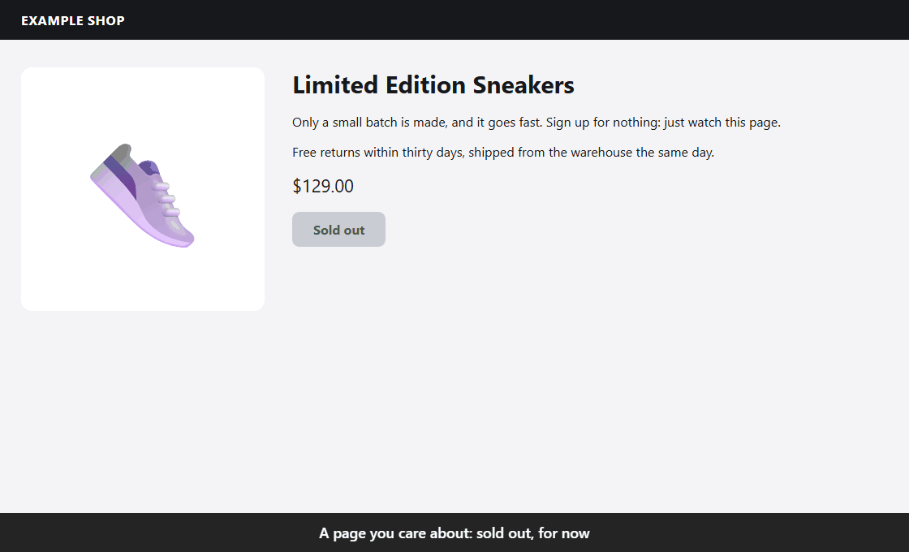
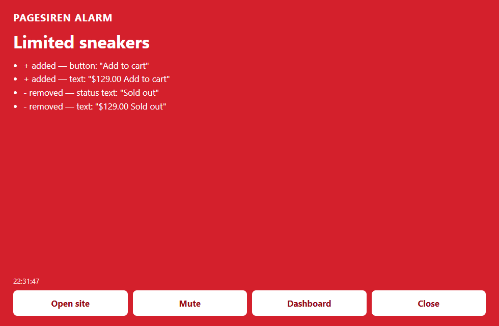
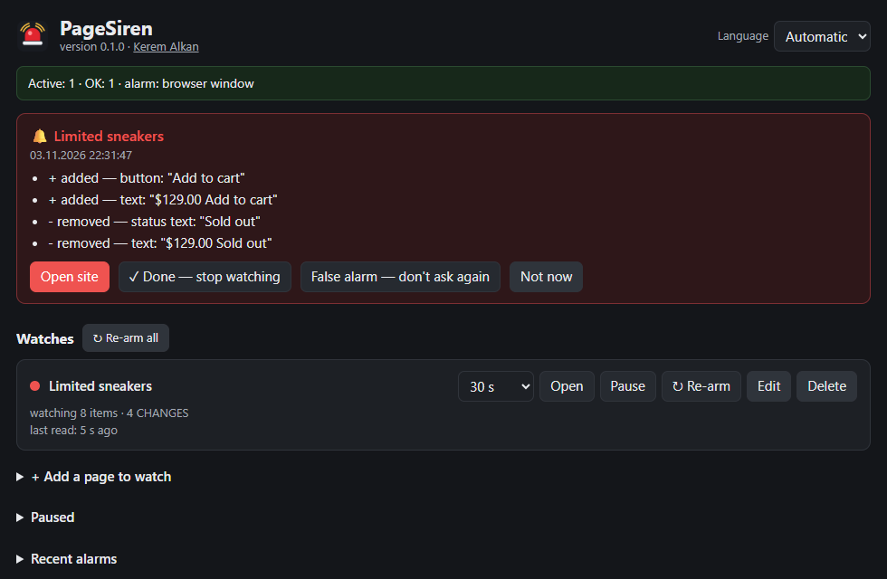

<p align="center">
  
</p>

<p align="center">
  <strong>Tickets back on sale. A restock. A free appointment slot. An exam result.</strong><br>
  Tell PageSiren which pages you care about. It stays quiet until something real changes, and then you can't miss it.
</p>

<p align="center">
  <a href="https://github.com/kerem-alkan/pagesiren/releases/latest/download/PageSiren-Setup.exe"></a>
  <a href="#macos-and-linux"></a>
  <a href="README.tr.md"></a>
</p>

<p align="center">
  <a href="https://github.com/kerem-alkan/pagesiren/actions/workflows/ci.yml"></a>
  <a href="https://github.com/kerem-alkan/pagesiren/releases/latest"></a>
  <a href="https://www.npmjs.com/package/pagesiren"></a>
  <a href="LICENSE"></a>
  
  
</p>

<p align="center">
  
</p>

<p align="center">
  <strong>Free and open source.</strong> No account, no cloud, no tracking, no limit on pages.<br>
  Created by <a href="https://github.com/kerem-alkan"><strong>Kerem Alkan</strong></a>.
</p>

## What people watch

<table>
  <tr>
    <td width="33%" valign="top"><strong>🎟️ Tickets</strong><br>A sold-out event gets new seats or resale tickets.</td>
    <td width="33%" valign="top"><strong>👟 Restocks and drops</strong><br>"Out of stock" disappears, or a limited drop goes live.</td>
    <td width="33%" valign="top"><strong>📅 Appointments</strong><br>A visa, hospital or government slot opens up.</td>
  </tr>
  <tr>
    <td valign="top"><strong>🎓 School and exams</strong><br>Course seats, exam results, admission lists.</td>
    <td valign="top"><strong>💼 Jobs and homes</strong><br>A new post on a careers page or a listings page.</td>
    <td valign="top"><strong>📣 Anything else</strong><br>"Coming soon" pages, announcements, price changes. If you keep pressing refresh, it can do that for you.</td>
  </tr>
</table>

## How it works

1. **Paste an address.** No account, nothing to configure.
2. **Forget about it.** It reads the page in the background, at the pace you choose. Cookie banners, ads and clocks are ignored.
3. **Hear the siren.** A red window over everything, a siren, and a list of exactly what changed. On your phone too, if you want.

<table>
  <tr>
    <td width="50%" align="center"><br><sub>The alarm: hard to miss</sub></td>
    <td width="50%" align="center"><br><sub>The dashboard: what changed, line by line</sub></td>
  </tr>
</table>

## Why PageSiren

- **Few false alarms.** Cookie banners, login pop-ups, account menus, empty carts, FAQ boxes, rotating ads, "3 minutes ago" and plain counters are filtered out, and a change has to survive two reads in a row.
- **It knows which way a change goes.** New content, or a "sold out" that disappears, raises the alarm. Something selling out doesn't wake you up. It recognizes "sold out" in more than 15 languages. Want every change instead? Tick one box.
- **Pages behind a login work.** It reads with a real browser that keeps its own profile. Press **Open** on a watch, log in once, and later reads stay logged in. If the session drops, it tells you.
- **Hard to miss.** A blinking red window on top of everything, with a siren. If you want it on your phone too: Telegram, Discord, ntfy or any webhook.
- **Honest about what it can't see.** Bot check, login wall, unreadable page: the watch turns orange and says why. A stale watch never looks green. If reading stops altogether, the siren goes off about that too.
- **Local and free.** No account, no cloud, no telemetry, no limit on watches. Your pages, sessions and settings stay on your computer.
- **Light.** Zero dependencies. The program itself uses about 70 MB; its browser opens only while reading and closes when idle. Pages that don't need JavaScript can be read with no browser at all.

## What it will not do

PageSiren only tells you. It does not buy, add to a cart, log in for you, fill in forms or hold seats. It does not solve captchas or get around bot protection or queues: it shows itself as a normal browser, with no disguise, and when a site puts up a wall it backs off and asks you to look.

Please use sensible intervals and respect each site's terms. You are responsible for how you use it.

## How it compares

| | **PageSiren** | Online monitoring services | [changedetection.io](https://github.com/dgtlmoon/changedetection.io) |
|---|---|---|---|
| Runs on | Your computer | Their servers | Your server, or their paid hosting |
| Account | None | Required | None if you host it yourself |
| Price | Free, no limits | Free tier, then monthly | Free if you host it yourself |
| Setup | One download | Sign up | Docker or Python |
| Pages behind your login | Log in once | Sometimes | Possible with browser steps |
| Alarm you can't miss | Red window and siren | Email or app notification | Notifications |

PageSiren is a small desktop tool for one person. If you want a server, teams, a visual selector and many more integrations, use changedetection.io. If you like the command line and cron, look at [urlwatch](https://github.com/thp/urlwatch). Both are excellent.

## Get started

### Windows

1. **Download [PageSiren-Setup.exe](https://github.com/kerem-alkan/pagesiren/releases/latest/download/PageSiren-Setup.exe)** (about 35 MB). Everything it needs is inside.
2. **Double-click it.** No admin rights, no terminal, nothing else to install.
3. **Add a page.** The dashboard opens in your browser. Press **+ Add a page to watch**, paste the address and press **Add**. That's all.

> [!NOTE]
> PageSiren is new and isn't code-signed yet, so your browser may ask if you want to keep the file, and Windows may say *Windows protected your PC*. Press **More info**, then **Run anyway**. [Why, and how to check the file](#why-does-windows-warn-me-about-the-installer).

It runs in the background, with an icon next to the clock. Tick **Start PageSiren when I log in** under **Settings** so it comes back after a restart. It reads pages with Edge, which every Windows has, or with Chrome or Brave.

> [!TIP]
> Press **Play a test alarm** under **Settings** once, so you know what the siren sounds like.

### macOS and Linux

You need [Node.js](https://nodejs.org) (version 22 or newer) and Chrome, Edge or Brave. Open a terminal, paste this and press Enter:

```bash
npx pagesiren
```

If it asks whether to install the package, press `y`. The dashboard opens in your browser at `http://127.0.0.1:47431/`. Keep the terminal window open and the computer awake while it watches.

To keep it installed, so you can start it any time by typing `pagesiren`:

```bash
npm install -g pagesiren
```

Then tick **Start PageSiren when I log in** under **Settings**, and it runs by itself from then on. These commands work on Windows too, if you prefer them.

## Questions

<details>
<summary><strong>Is it really free?</strong></summary>

Yes. MIT license, no paid version, no limits, no account. It runs on your own computer.
</details>

<a id="why-does-windows-warn-me-about-the-installer"></a>
<details>
<summary><strong>Why does Windows warn me about the installer?</strong></summary>

Because it's new and isn't code-signed, not because anything was found in it. Windows warns about any program it hasn't seen many people run.

You don't have to take my word for it. The installer is built from this public source by GitHub Actions, and the Node.js inside it is the official signed one. You can compare it with the SHA-256 file on the [release page](https://github.com/kerem-alkan/pagesiren/releases/latest), or check where it came from:

```bash
gh attestation verify PageSiren-Setup.exe --repo kerem-alkan/pagesiren
```
</details>

<details>
<summary><strong>Will it buy the ticket or book the slot for me?</strong></summary>

No, and it never will. It tells you, and you do the rest.
</details>

<details>
<summary><strong>Will a website block me?</strong></summary>

It reads like a normal visitor, at the pace you choose, with no disguise. If a site puts up a bot check or a queue, it doesn't push through: it backs off and tells you. Use sensible intervals and respect each site's terms.
</details>

<details>
<summary><strong>Does it work when my computer is off?</strong></summary>

No. It runs on your computer, so the computer has to be on and awake. That's the price of having no account and no cloud.
</details>

<details>
<summary><strong>Can I get the alarm on my phone?</strong></summary>

Yes: Telegram, Discord, ntfy or any webhook. Set them up under **Notifications** on the dashboard; each one has a test button. Your computer still does the watching.
</details>

<details>
<summary><strong>Can it watch pages I have to log in to?</strong></summary>

Yes. Press **Open** on the watch and log in once in the window that appears. Later reads stay logged in, and if the session drops, it tells you.
</details>

<details>
<summary><strong>Where does my data go?</strong></summary>

Nowhere. The only requests it makes are to the pages you add and the notification channels you set up. Everything is kept in one folder on your computer. That folder holds your login cookies, so treat it as private.
</details>

<details>
<summary><strong>Does it work on Mac and Linux?</strong></summary>

Windows is what this has been used on every day. macOS and Linux should work but are new and much less tested, so reports are very welcome.
</details>

## All the details

<details>
<summary><strong>Options for each page</strong></summary>

| Option | What it does |
|---|---|
| How often | From 30 seconds to 30 minutes. 5 minutes is a kind default. |
| Words | Alarm only if a change contains one of these words. "Sold out" going away always counts. |
| Alarm on every change | Turns off the direction rule. |
| Login check | Text you can only see when logged in. If it disappears, you get told once instead of watching a logged-out page. You can leave it empty: a logout link disappearing from the page counts too. |
| Fast | Alarm on the first read when "sold out" goes away, for things that vanish in a minute. |
| Keep the tab open | For slow pages that only fill in after a while. |
| Who reads the page | Separate browser (default), plain HTTP (lightest), or your own Chrome through the extension. |

Other things on the dashboard: **Re-arm** makes a page's current state the new normal, **False alarm** teaches it to ignore that change, and **Export / Import** moves your list to another computer.
</details>

<details>
<summary><strong>Alarms and notifications</strong></summary>

| | Windows | macOS, Linux |
|---|---|---|
| Alarm window | Red desktop window above everything | Red browser window |
| Sound | Yes | Yes |
| Phone (optional) | Telegram, Discord, ntfy, webhook | Telegram, Discord, ntfy, webhook |

On Windows the desktop window comes from a small helper. There is no binary in this repository: at first run it is built from [its source](windows-helper/PageSirenAlarm.cs) with the C# compiler that ships with Windows. If that fails, the browser window takes over. The installer on the [releases page](https://github.com/kerem-alkan/pagesiren/releases/latest) is built from [this source](windows-installer/PageSirenSetup.cs) by GitHub Actions.

Notifications are off until you fill them in under **Notifications** on the dashboard.
</details>

<details>
<summary><strong>Command line</strong></summary>

```text
pagesiren [--port <n>] [--data <folder>] [--chrome <path>] [--lang <en|tr>] [--no-open] [--no-helper]
```
</details>

<details>
<summary><strong>Chrome extension (optional)</strong></summary>

The `extension` folder also works by itself: go to `chrome://extensions`, turn on Developer mode, press **Load unpacked** and pick the folder. It then reads pages in your everyday Chrome, which helps with the few sites that only trust that browser. On Windows it can also work next to the program: choose *My Chrome extension* on a watch.
</details>

<details>
<summary><strong>Your data, and removing it</strong></summary>

Everything lives in one folder. The browser profile in it holds your login cookies, so treat it as private.

| Windows | macOS | Linux |
|---|---|---|
| `%LOCALAPPDATA%\PageSiren` | `~/Library/Application Support/PageSiren` | `~/.local/share/pagesiren` |

To remove PageSiren on Windows, use **Settings > Apps** like any other program: it asks whether to delete your watches and logins too. If you installed it with npm: turn off *Start PageSiren when I log in*, quit it (tray icon, or Ctrl+C), delete that folder, and run `npm uninstall -g pagesiren`.
</details>

## What's next

- [x] One-click download for Windows, no terminal needed
- [ ] Code signing, so Windows stops warning
- [x] A shorter install: `npx pagesiren`
- [ ] Chrome Web Store
- [x] German and Spanish
- [ ] More languages
- [ ] Real-world reports from macOS and Linux

## Help out

The most useful thing you can send is a page that misbehaves: [a false alarm or a missed change](https://github.com/kerem-alkan/pagesiren/issues/new?template=false_alarm.yml). Other easy ways in:

- **Try it on macOS or Linux** and say what happened.
- **Add your language.** It's one block of text, and [here's how](CONTRIBUTING.md#adding-a-language). Teaching it "sold out" in your language helps too.
- **Tell a friend** who keeps pressing refresh.

If PageSiren caught something for you, a ⭐ helps other people find it.

## Development

```bash
npm test
```

No build step and no dependencies. See [how it works](docs/ARCHITECTURE.md) and [CONTRIBUTING](CONTRIBUTING.md). Security reports: [SECURITY](SECURITY.md). Please follow the [code of conduct](CODE_OF_CONDUCT.md).

Created and maintained by [Kerem Alkan](https://github.com/kerem-alkan), with heavy help from an AI assistant (Claude). It has been used every day on real pages. The tests are real; read the code and judge for yourself.

## Contact

Bugs and ideas: [issues](https://github.com/kerem-alkan/pagesiren/issues). Anything else: [contact@keremalkan.com](mailto:contact@keremalkan.com).

## License

[MIT](LICENSE) © 2026 Kerem Alkan. In plain words: you can use it, change it and share it freely, as long as the license and copyright notice stay with it.

Not affiliated with any website. Site names that appear in the tests are only there to reproduce real page behaviour.
