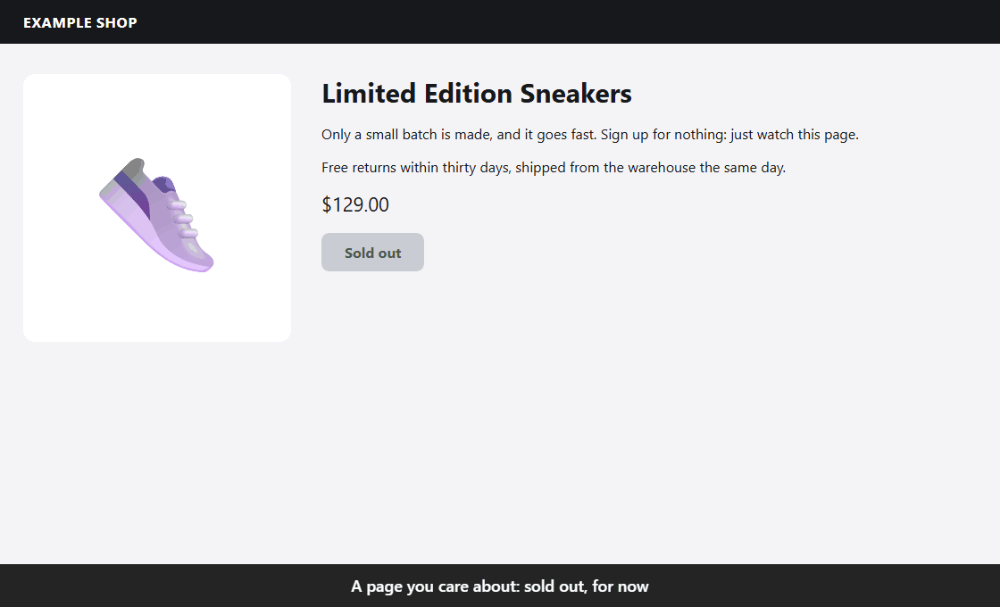

<p align="center">
  
</p>
<h1 align="center">PageSiren</h1>
<p align="center">
  <strong>Web sayfaları için bir siren.</strong><br>
  Hangi sayfaları önemsediğinizi söyleyin. Gerçek bir değişiklik olana kadar sessiz kalır, olunca da kaçırmanız mümkün değildir.
</p>
<p align="center"><a href="https://github.com/kerem-alkan"><strong>Kerem Alkan</strong></a> tarafından geliştirildi</p>
<p align="center"><a href="README.md">English</a></p>

<p align="center">
  
</p>

## Deneyin

[Node.js 22 veya üstü](https://nodejs.org) ile Chrome, Edge ya da Brave gerekir.

```bash
npx github:kerem-alkan/pagesiren
```

Takip ekranı `http://127.0.0.1:47431/` adresinde açılır. Sayfa adresini yapıştırıp **Ekle**'ye basın, hepsi bu.

Kalıcı kurmak için:

```bash
npm install -g github:kerem-alkan/pagesiren
```

Sonra `pagesiren` yazarak başlatabilirsiniz. **Ayarlar**'dan oturum açınca kendiliğinden başlamasını sağlayabilirsiniz.

## Ne izlenir

Stoğa giren ürünler, biletler ve ikinci el satışlar, randevu boşlukları, kurs kontenjanları, vize ve kamu sayfaları, iş ilanları, "yakında" sayfaları: sürekli yenile tuşuna basacağınız her sayfa.

## Neden PageSiren

- **Az yanlış alarm.** Çerez pencereleri, giriş kutuları, SSS blokları, hesap adları, dönen reklamlar, "3 dakika önce" yazıları ve sayaçlar elenir. Bir değişiklik arka arkaya iki okumada da görülmelidir.
- **Değişikliğin yönünü bilir.** Yeni bir şey gelirse ya da "tükendi" yazısı kalkarsa alarm verir. Bir şeyin tükenmesi sizi uyandırmaz. "Tükendi"yi 15'ten fazla dilde tanır. Her değişikliği mi istiyorsunuz? Tek kutu.
- **Giriş isteyen sayfalar çalışır.** Kendi profili olan gerçek bir tarayıcıyla okur. İzlemedeki **Aç** düğmesine basıp bir kez giriş yapın, sonraki okumalar girişli kalır. Oturum düşerse size söyler.
- **Kaçırılması zor.** Her şeyin üstünde yanıp sönen kırmızı pencere ve siren. Telefona da gelsin isterseniz: Telegram, Discord, ntfy ya da herhangi bir webhook.
- **Göremediğini saklamaz.** Bot kontrolü, giriş duvarı, okunamayan sayfa: izleme turuncuya döner ve nedenini yazar. Bayat izleme asla yeşil görünmez. Okuma tamamen durursa siren bunun için de çalar.
- **Yerel ve ücretsiz.** Hesap yok, bulut yok, veri toplama yok, izleme sınırı yok. Sayfalarınız, oturumlarınız ve ayarlarınız bilgisayarınızda kalır.
- **Hafif.** Hiç bağımlılığı yok. Programın kendisi yaklaşık 70 MB kullanır; tarayıcısı sadece okurken açılır, boştayken kapanır. JavaScript gerektirmeyen sayfalar tarayıcısız da okunabilir.

## Ne yapmaz

PageSiren sadece haber verir. Satın almaz, sepete eklemez, sizin yerinize giriş yapmaz, form doldurmaz, koltuk tutmaz. Captcha çözmez, bot korumasını ya da kuyrukları atlatmaz: kendini olduğu gibi, kılık değiştirmeden gösterir; site duvar çıkarırsa geri çekilir ve size bakmanızı söyler.

Lütfen makul aralıklar kullanın ve sitelerin kurallarına uyun. Kullanım sorumluluğu size aittir.

## Alarm ve bildirimler

| | Windows | macOS, Linux |
|---|---|---|
| Alarm penceresi | Her şeyin üstünde kırmızı masaüstü penceresi | Kırmızı tarayıcı penceresi |
| Ses | Var | Var |
| Telefon (isteğe bağlı) | Telegram, Discord, ntfy, webhook | Telegram, Discord, ntfy, webhook |

Windows'taki masaüstü penceresi küçük bir yardımcıdan gelir. Bu depoda hazır exe yoktur: ilk çalıştırmada [kaynağından](windows-helper/PageSirenAlarm.cs) Windows'la gelen C# derleyicisiyle derlenir. Olmazsa tarayıcı penceresi devreye girer.

Bildirimler, takip ekranındaki **Bildirimler** bölümünü doldurana kadar kapalıdır. Her kanalın bir test düğmesi vardır.

**Platformlar:** Her gün kullanıldığı yer Windows. macOS ve Linux'ta çalışması beklenir ama yeni ve çok daha az denenmiştir, geri bildirimleriniz çok değerli.

## Verileriniz ve kaldırma

Her şey tek klasörde durur. İçindeki tarayıcı profili giriş çerezlerinizi tutar, özel olarak düşünün.

| Windows | macOS | Linux |
|---|---|---|
| `%LOCALAPPDATA%\PageSiren` | `~/Library/Application Support/PageSiren` | `~/.local/share/pagesiren` |

Kaldırmak için: *Oturum açınca başlasın* ayarını kapatın, programı kapatın (saat yanındaki simge ya da Ctrl+C), bu klasörü silin; kurduysanız `npm uninstall -g pagesiren` çalıştırın.

## Geliştirme

```bash
npm test
```

Derleme adımı ve bağımlılık yok. Ayrıntılar İngilizce: [nasıl çalışır](docs/ARCHITECTURE.md), [katkı](CONTRIBUTING.md), [güvenlik](SECURITY.md).

[Kerem Alkan](https://github.com/kerem-alkan) tarafından geliştirildi ve sürdürülüyor; bir yapay zekâ asistanının (Claude) yoğun yardımı alındı. Her gün gerçek sayfalarda kullanıldı. Testler gerçek; kodu okuyup kendiniz karar verin.

## İletişim

Hata ve öneriler: [issues](https://github.com/kerem-alkan/pagesiren/issues). Diğer her şey: [contact@keremalkan.com](mailto:contact@keremalkan.com).

## Lisans

[MIT](LICENSE) © 2026 Kerem Alkan. Lisans ve telif satırı korunduğu sürece özgürce kullanabilir, değiştirebilir ve paylaşabilirsiniz.

Hiçbir web sitesiyle bağlantısı yoktur. Testlerde geçen site adları sadece gerçek sayfa davranışlarını yeniden üretmek içindir.
