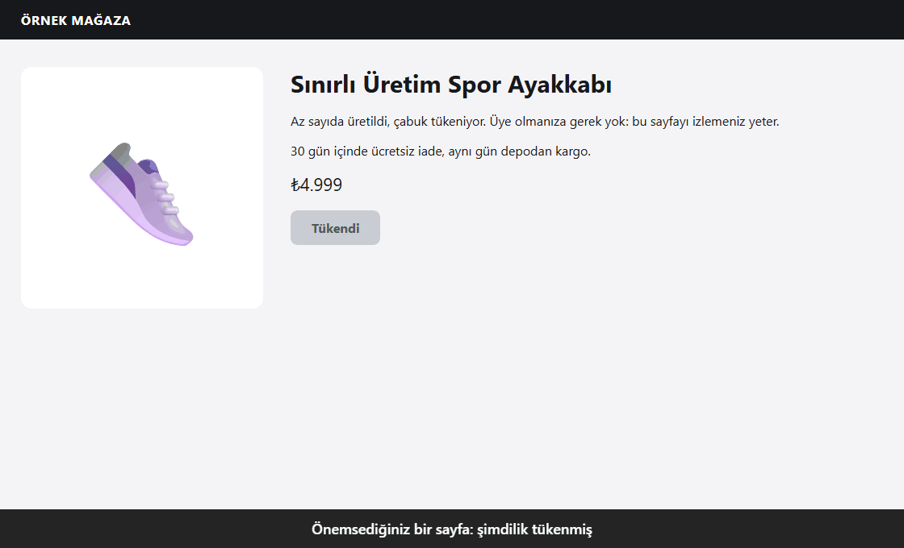
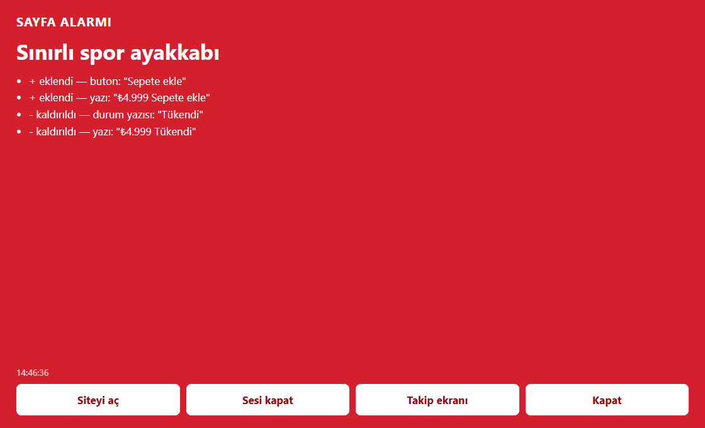
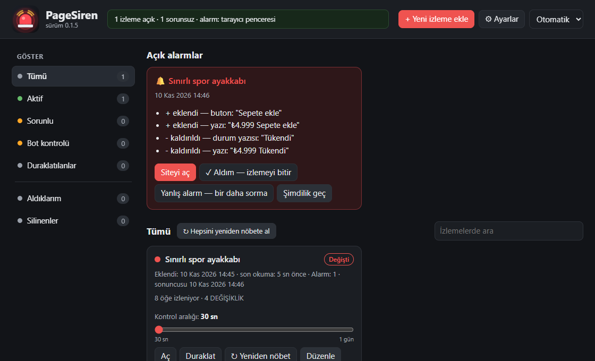

<p align="center">
  
</p>

<p align="center">
  <strong>Yeniden satışa çıkan bilet. Stoğa giren ürün. Açılan randevu. Açıklanan sınav sonucu.</strong><br>
  Hangi sayfaları önemsediğinizi PageSiren'e söyleyin. Gerçek bir değişiklik olana kadar sessiz kalır, olunca da kaçırmanız mümkün değildir.
</p>

<p align="center">
  <a href="https://github.com/kerem-alkan/pagesiren/releases/latest/download/PageSiren-Setup.exe"></a>
  <a href="#macos-ve-linux"></a>
  <a href="README.md"></a>
</p>

<p align="center">
  <a href="https://github.com/kerem-alkan/pagesiren/actions/workflows/ci.yml"></a>
  <a href="https://github.com/kerem-alkan/pagesiren/releases/latest"></a>
  <a href="https://www.npmjs.com/package/pagesiren"></a>
  <a href="LICENSE"></a>
  
  
</p>

<p align="center">
  
</p>

<p align="center">
  <strong>Ücretsiz ve açık kaynak.</strong> Hesap yok, bulut yok, veri toplama yok, sayfa sınırı yok.<br>
  <a href="https://github.com/kerem-alkan"><strong>Kerem Alkan</strong></a> tarafından geliştirildi.
</p>

## Ne izlenir

<table>
  <tr>
    <td width="33%" valign="top"><strong>🎟️ Biletler</strong><br>Tükenmiş bir etkinliğe yeni koltuk ya da ikinci el bilet düşer.</td>
    <td width="33%" valign="top"><strong>👟 Stok ve sınırlı ürünler</strong><br>"Tükendi" yazısı kalkar ya da sınırlı ürün satışa çıkar.</td>
    <td width="33%" valign="top"><strong>📅 Randevular</strong><br>Vize, hastane ya da kamu randevusu açılır.</td>
  </tr>
  <tr>
    <td valign="top"><strong>🎓 Okul ve sınav</strong><br>Kurs kontenjanı, sınav sonucu, kabul listesi.</td>
    <td valign="top"><strong>💼 İş ve ev</strong><br>Kariyer sayfasında ya da ilan listesinde yeni ilan.</td>
    <td valign="top"><strong>📣 Diğer her şey</strong><br>"Yakında" sayfaları, duyurular, fiyat değişiklikleri. Sürekli yenilediğiniz sayfayı o sizin yerinize yeniler.</td>
  </tr>
</table>

## Nasıl çalışır

1. **Adresi yapıştırın.** Hesap yok, ayar yok.
2. **Unutun.** Sayfayı arka planda, seçtiğiniz aralıkla okur. Çerez kutuları, reklamlar ve saatler elenir.
3. **Sireni duyun.** Her şeyin üstünde kırmızı pencere, siren ve tam olarak neyin değiştiğinin listesi. İsterseniz telefonunuza da gelir.

<table>
  <tr>
    <td width="50%" align="center"><br><sub>Alarm: kaçırılması zor</sub></td>
    <td width="50%" align="center"><br><sub>Takip ekranı: satır satır neyin değiştiği</sub></td>
  </tr>
</table>

## Neden PageSiren

- **Az yanlış alarm.** Çerez pencereleri, giriş kutuları, hesap menüleri, boş sepetler, SSS blokları, dönen reklamlar, "3 dakika önce" yazıları ve sayaçlar elenir. Bir değişiklik arka arkaya iki okumada da görülmelidir.
- **Değişikliğin yönünü bilir.** Yeni bir şey gelirse ya da "tükendi" yazısı kalkarsa alarm verir. Bir şeyin tükenmesi sizi uyandırmaz. "Tükendi"yi 15'ten fazla dilde tanır. Her değişikliği mi istiyorsunuz? Tek kutu.
- **Giriş isteyen sayfalar çalışır.** Kendi profili olan gerçek bir tarayıcıyla okur. İzlemedeki **Aç** düğmesine basıp bir kez giriş yapın, sonraki okumalar girişli kalır. Oturum düşerse size söyler.
- **Kaçırılması zor.** Her şeyin üstünde yanıp sönen kırmızı pencere ve siren. Telefona da gelsin isterseniz: Telegram, Discord, ntfy ya da herhangi bir webhook.
- **Göremediğini saklamaz.** Bot kontrolü, giriş duvarı, okunamayan sayfa: izleme turuncuya döner ve nedenini yazar. Bayat izleme asla yeşil görünmez. Okuma tamamen durursa siren bunun için de çalar.
- **Yerel ve ücretsiz.** Hesap yok, bulut yok, veri toplama yok, izleme sınırı yok. Sayfalarınız, oturumlarınız ve ayarlarınız bilgisayarınızda kalır.
- **Hafif.** Hiç bağımlılığı yok. Programın kendisi yaklaşık 70 MB kullanır; tarayıcısı sadece okurken açılır, boştayken kapanır. JavaScript gerektirmeyen sayfalar tarayıcısız da okunabilir.

## Ne yapmaz

PageSiren sadece haber verir. Satın almaz, sepete eklemez, sizin yerinize giriş yapmaz, form doldurmaz, koltuk tutmaz. Captcha çözmez, bot korumasını ya da kuyrukları atlatmaz: kendini olduğu gibi, kılık değiştirmeden gösterir; site duvar çıkarırsa geri çekilir ve size bakmanızı söyler.

Lütfen makul aralıklar kullanın ve sitelerin kurallarına uyun. Kullanım sorumluluğu size aittir.

## Diğerlerinden farkı

| | **PageSiren** | Çevrim içi izleme servisleri | [changedetection.io](https://github.com/dgtlmoon/changedetection.io) |
|---|---|---|---|
| Nerede çalışır | Kendi bilgisayarınızda | Onların sunucusunda | Kendi sunucunuzda ya da ücretli barındırmada |
| Hesap | Yok | Gerekir | Kendiniz kurarsanız yok |
| Ücret | Ücretsiz, sınır yok | Ücretsiz katman, sonra aylık | Kendiniz kurarsanız ücretsiz |
| Kurulum | Tek indirme | Üyelik | Docker ya da Python |
| Giriş isteyen sayfalar | Bir kez giriş yapmanız yeter | Bazen | Tarayıcı adımlarıyla mümkün |
| Kaçırılmaz alarm | Kırmızı pencere ve siren | E-posta ya da uygulama bildirimi | Bildirimler |

PageSiren tek kişilik, küçük bir masaüstü aracıdır. Sunucu, ekip, görsel seçici ve çok daha fazla entegrasyon istiyorsanız changedetection.io'yu kullanın. Komut satırını ve cron'u seviyorsanız [urlwatch](https://github.com/thp/urlwatch)'a bakın. İkisi de çok iyi.

## Hemen başlayın

### Windows

1. **[PageSiren-Setup.exe](https://github.com/kerem-alkan/pagesiren/releases/latest/download/PageSiren-Setup.exe) dosyasını indirin** (yaklaşık 35 MB). Gereken her şey içinde.
2. **Çift tıklayın.** Yönetici izni yok, terminal yok, başka kurulacak bir şey yok.
3. **Sayfa ekleyin.** Takip ekranı tarayıcınızda açılır. **+ Yeni izleme ekle**'ye basın, sayfa adresini yapıştırın, **Ekle**'ye basın. Hepsi bu.

> [!NOTE]
> PageSiren yeni ve henüz kod imzası yok. Bu yüzden tarayıcınız dosyayı tutmak isteyip istemediğinizi sorabilir, Windows da *Windows kişisel bilgisayarınızı korudu* diyebilir. **Ek bilgi**'ye, sonra **Yine de çalıştır**'a basın. [Neden, ve dosyayı nasıl kontrol edersiniz](#windows-kurulumda-neden-uyarı-veriyor).

Arka planda çalışır, simgesi saatin yanında durur. Bilgisayar yeniden başlayınca da çalışsın diye **Ayarlar**'dan **Oturum açınca PageSiren başlasın** kutusunu işaretleyin. Sayfaları her Windows'ta bulunan Edge ile ya da Chrome veya Brave ile okur.

> [!TIP]
> **Ayarlar** bölümündeki **Test alarmı çal** düğmesine bir kez basın, sirenin sesini bilin.

### macOS ve Linux

[Node.js](https://nodejs.org) (22 veya üstü) ile Chrome, Edge ya da Brave gerekir. Terminali açın, şunu yapıştırıp Enter'a basın:

```bash
npx pagesiren
```

Paketi kurmak isteyip istemediğinizi sorarsa `y`'ye basın. Takip ekranı tarayıcınızda `http://127.0.0.1:47431/` adresinde açılır. İzleme sürerken terminal penceresi açık, bilgisayar da uyanık kalmalı.

Kalıcı kurmak, istediğiniz zaman `pagesiren` yazarak başlatmak için:

```bash
npm install -g pagesiren
```

Sonra **Ayarlar**'dan **Oturum açınca PageSiren başlasın** kutusunu işaretleyin, bundan sonra kendiliğinden çalışır. Bu komutlar isterseniz Windows'ta da çalışır.

## Sorular

<details>
<summary><strong>Gerçekten ücretsiz mi?</strong></summary>

Evet. MIT lisanslı, ücretli sürümü yok, sınır yok, hesap yok. Kendi bilgisayarınızda çalışır.
</details>

<a id="windows-kurulumda-neden-uyarı-veriyor"></a>
<details>
<summary><strong>Windows kurulumda neden uyarı veriyor?</strong></summary>

Yeni olduğu ve kod imzası bulunmadığı için, içinde bir şey bulunduğu için değil. Windows, çok kişinin çalıştırmadığı her programda uyarır.

Sözüme güvenmek zorunda değilsiniz. Kurulum dosyası bu açık kaynaktan GitHub Actions ile derlenir, içindeki Node.js de resmî imzalı sürümdür. Dosyayı [sürüm sayfasındaki](https://github.com/kerem-alkan/pagesiren/releases/latest) SHA-256 ile karşılaştırabilir ya da nereden geldiğini kontrol edebilirsiniz:

```bash
gh attestation verify PageSiren-Setup.exe --repo kerem-alkan/pagesiren
```
</details>

<details>
<summary><strong>Bileti alır ya da randevuyu tutar mı?</strong></summary>

Hayır, ileride de yapmayacak. Size haber verir, gerisi sizde.
</details>

<details>
<summary><strong>Site beni engeller mi?</strong></summary>

Normal bir ziyaretçi gibi, seçtiğiniz aralıkla ve kılık değiştirmeden okur. Site bot kontrolü ya da kuyruk çıkarırsa zorlamaz, geri çekilir ve size söyler. Makul aralıklar kullanın, sitelerin kurallarına uyun.
</details>

<details>
<summary><strong>Bilgisayarım kapalıyken çalışır mı?</strong></summary>

Hayır. Kendi bilgisayarınızda çalıştığı için bilgisayar açık ve uyanık olmalı. Hesapsız ve bulutsuz olmanın bedeli bu.
</details>

<details>
<summary><strong>Alarm telefonuma gelir mi?</strong></summary>

Evet: Telegram, Discord, ntfy ya da herhangi bir webhook. Takip ekranındaki **Bildirimler** bölümünden ayarlanır, her kanalın test düğmesi vardır. İzlemeyi yine bilgisayarınız yapar.
</details>

<details>
<summary><strong>Giriş isteyen sayfaları izleyebilir mi?</strong></summary>

Evet. İzlemedeki **Aç** düğmesine basın, açılan pencerede bir kez giriş yapın. Sonraki okumalar girişli kalır, oturum düşerse size söyler.
</details>

<details>
<summary><strong>Verilerim nereye gidiyor?</strong></summary>

Hiçbir yere. Program sadece eklediğiniz sayfalara ve kurduğunuz bildirim kanallarına istek gönderir. Her şey bilgisayarınızda tek klasörde durur. O klasör giriş çerezlerinizi de tutar, özel olarak düşünün.
</details>

<details>
<summary><strong>Mac ve Linux'ta çalışır mı?</strong></summary>

Her gün kullanıldığı yer Windows. macOS ve Linux'ta da her değişiklikte program baştan sona, gerçek bir tarayıcıyla test ediliyor, ama orada henüz her gün kullanan yok. Geri bildirimleriniz çok değerli.
</details>

## Tüm ayrıntılar

<details>
<summary><strong>Her sayfanın seçenekleri</strong></summary>

| Seçenek | Ne yapar |
|---|---|
| Ne sıklıkla baksın | 30 saniyeden bir güne kadar, her kartta bir kaydırma çubuğuyla. Değişiklik bir sonraki okumada geçerli olur. 5 dakika sitelere karşı nazik bir aralıktır. |
| Kelimeler | Sadece değişiklikte bu kelimelerden biri geçerse alarm verir. "Tükendi" yazısının kalkması her zaman sayılır. |
| Her değişiklikte alarm ver | Yön kuralını kapatır. |
| Giriş kontrolü | Sadece giriş yapınca görünen bir yazı. Kaybolursa, çıkış yapılmış sayfayı izlemek yerine size bir kez söyler. Boş bırakabilirsiniz: sayfadaki çıkış linkinin kaybolması da aynı uyarıyı verir. |
| Hızlı | "Tükendi" kalkınca ilk okumada alarm verir, bir dakikada biten şeyler için. |
| Sekmeyi açık tut | Geç dolan yavaş sayfalar için. |
| Sayfayı kim okusun | Ayrı tarayıcı (varsayılan), düz HTTP (en hafif) ya da eklentiyle kendi Chrome'unuz. |

Soldaki sütun listeyi süzer: aktif, sorunlu, bot kontrolü, duraklatılanlar ve geri alınabilen iki geçmiş, işi biten sayfalar için **Aldıklarım** ve **Silinenler**. Bir karta tıklayınca adresini ve kendi alarm geçmişini görürsünüz; her kart ne zaman eklendiğini de gösterir.

Takip ekranında ayrıca: **Yeniden nöbet** sayfanın şu anki halini yeni normal yapar, **Yanlış alarm** o değişikliği görmezden gelmeyi öğretir, **İzlemeleri dışa/içe aktar** listenizi başka bilgisayara taşır.
</details>

<details>
<summary><strong>Alarm ve bildirimler</strong></summary>

| | Windows | macOS, Linux |
|---|---|---|
| Alarm penceresi | Her şeyin üstünde kırmızı masaüstü penceresi | Kırmızı tarayıcı penceresi |
| Ses | Var | Var |
| Telefon (isteğe bağlı) | Telegram, Discord, ntfy, webhook | Telegram, Discord, ntfy, webhook |

Windows'taki masaüstü penceresi küçük bir yardımcıdan gelir. Bu depoda hazır exe yoktur: ilk çalıştırmada [kaynağından](windows-helper/PageSirenAlarm.cs) Windows'la gelen C# derleyicisiyle derlenir. Olmazsa tarayıcı penceresi devreye girer. [Sürümler sayfasındaki](https://github.com/kerem-alkan/pagesiren/releases/latest) kurulum dosyası [bu kaynaktan](windows-installer/PageSirenSetup.cs) GitHub Actions ile derlenir.

Bildirimler, takip ekranındaki **Bildirimler** bölümünü doldurana kadar kapalıdır.
</details>

<details>
<summary><strong>Komut satırı</strong></summary>

```text
pagesiren [--port <n>] [--data <klasör>] [--chrome <yol>] [--lang <en|tr>] [--no-open] [--no-helper]
```
</details>

<details>
<summary><strong>Chrome eklentisi (isteğe bağlı)</strong></summary>

`extension` klasörü tek başına da çalışır: `chrome://extensions` sayfasına gidin, Geliştirici modunu açın, **Paketlenmemiş öğe yükle**'ye basıp klasörü seçin. Böylece sayfaları her gün kullandığınız Chrome'da okur; bu, sadece o tarayıcıya güvenen az sayıdaki sitede işe yarar. Windows'ta programın yanında da çalışabilir: izlemede *Chrome eklentim* seçeneğini seçin.
</details>

<details>
<summary><strong>Verileriniz ve kaldırma</strong></summary>

Her şey tek klasörde durur. İçindeki tarayıcı profili giriş çerezlerinizi tutar, özel olarak düşünün.

| Windows | macOS | Linux |
|---|---|---|
| `%LOCALAPPDATA%\PageSiren` | `~/Library/Application Support/PageSiren` | `~/.local/share/pagesiren` |

Windows'ta kaldırmak için diğer programlar gibi **Ayarlar > Uygulamalar**'ı kullanın: izlemeleriniz ve girişleriniz de silinsin mi diye sorar. npm ile kurduysanız: *Oturum açınca PageSiren başlasın* ayarını kapatın, programı kapatın (saat yanındaki simge ya da Ctrl+C), bu klasörü silin ve `npm uninstall -g pagesiren` çalıştırın.
</details>

## Sırada ne var

- [x] Windows için tek tıkla indirme, terminal gerekmeden
- [ ] Kod imzası, Windows uyarmasın diye
- [x] Daha kısa kurulum: `npx pagesiren`
- [ ] Chrome Web Mağazası
- [x] Almanca ve İspanyolca
- [ ] Daha fazla dil
- [ ] macOS ve Linux'tan gerçek kullanım raporları

## Katkıda bulunun

En işe yarayan katkı, yanlış çalışan bir sayfayı bildirmektir: [yanlış alarm ya da kaçan değişiklik](https://github.com/kerem-alkan/pagesiren/issues/new?template=false_alarm.yml). Diğer kolay yollar:

- **macOS ya da Linux'ta deneyin** ve ne olduğunu yazın.
- **Dilinizi ekleyin.** Tek bir metin bloğu, [nasıl yapılacağı burada](CONTRIBUTING.md#adding-a-language). "Tükendi"yi kendi dilinizde öğretmek de işe yarar.
- **Sürekli yenile tuşuna basan bir arkadaşınıza söyleyin.**

PageSiren işinize yaradıysa bir ⭐ başkalarının da bulmasına yardım eder.

## Geliştirme

```bash
npm test
```

Derleme adımı ve bağımlılık yok. Ayrıntılar İngilizce: [nasıl çalışır](docs/ARCHITECTURE.md), [katkı](CONTRIBUTING.md), [güvenlik](SECURITY.md), [davranış kuralları](CODE_OF_CONDUCT.md).

[Kerem Alkan](https://github.com/kerem-alkan) tarafından geliştirildi ve sürdürülüyor; bir yapay zekâ asistanının (Claude) yoğun yardımı alındı. Her gün gerçek sayfalarda kullanıldı. Testler gerçek; kodu okuyup kendiniz karar verin.

## İletişim

Hata ve öneriler: [issues](https://github.com/kerem-alkan/pagesiren/issues). Diğer her şey: [contact@keremalkan.com](mailto:contact@keremalkan.com).

## Lisans

[MIT](LICENSE) © 2026 Kerem Alkan. Kısacası: lisans ve telif satırı korunduğu sürece özgürce kullanabilir, değiştirebilir ve paylaşabilirsiniz.

Hiçbir web sitesiyle bağlantısı yoktur. Testlerde geçen site adları sadece gerçek sayfa davranışlarını yeniden üretmek içindir.
